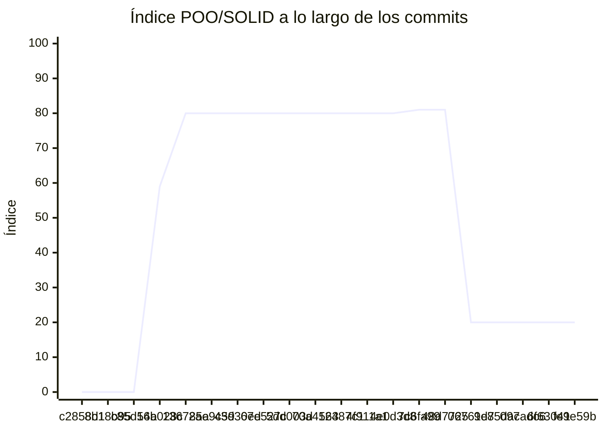

<!-- evaluacion:inicio -->
# Evaluación — Fisicos-informaticos/Tiro_Parab-lico

> Documento **generado automáticamente** por la cátedra de Programación II (RepoSense + análisis de calidad POO/SOLID). **No editar a mano**: se regenera en cada evaluación.
> Rama evaluada: `main`. Análisis **heurístico** (regex + métricas): es una criba para orientar la revisión, **no una nota**.
> Generado: 2026-11-27.

## 1. Veredicto

| Aspecto | Resultado |
|---|---|
| Índice de calidad POO/SOLID | **20/100** |
| Commit evaluado | `fe9e59b51ee8` (2026-11-25) |
| Código (LOC) | 6,651 |
| Archivos de código | 147 |
| Clases (bien usadas) | 216 (117 OK) |
| Código dentro de clases (%POO) | 97% |
| Funciones fuera de clases | 11 |
| Duplicación lógica | 5.9% |
| Señales S/O/L/I/D | 45/0/0/1/11 |
| Tope duro aplicado | `SUELTAS>=10` → índice ≤ 20 |

> Este informe **describe** lo que el análisis midió con los criterios ya establecidos de la materia. No es una nota.

### Semáforo de aprobación

Criterios de `CRITERIOS-CALIDAD.md`. **Aprobar** se juega con el perfil `estandar`; **destacar**, con el `exigente` (meta de excelencia).

| Semáforo | Resultado |
|---|---|
| Aprobar (`estandar`) | **no cumple** — 2/4 |
| Destacar (`exigente`) | **no cumple** — 1/5 |

**Criterios para aprobar**

| Criterio | Requisito | Tu resultado | Cumple |
|---|---|---|---|
| Código dentro de clases (%POO) | ≥ 85% | 97% | sí |
| Duplicación lógica | ≤ 10% | 5.9% | sí |
| Funciones fuera de clases | ≤ 1 | 11 | no |
| Señales POO/SOLID críticas | ninguna | Baja cohesión (LCOM), Acoplamiento alto (CBO) | no |

**Criterios para destacar**

| Criterio | Requisito | Tu resultado | Cumple |
|---|---|---|---|
| Código dentro de clases (%POO) | ≥ 95% | 97% | sí |
| Duplicación lógica | ≤ 5% | 5.9% | no |
| Funciones fuera de clases | ≤ 1 | 11 | no |
| Señales POO/SOLID críticas | ninguna | Clase demasiado grande (SRP), Baja cohesión (LCOM), Acoplamiento alto (CBO), Interfaz con demasiados métodos (ISP) | no |
| Índice de calidad POO/SOLID | ≥ 60 | 20/100 | no |

### Última actividad en cualquier rama

> Datos al cierre de la evaluación, antes de publicar este informe. Se revisan todas las ramas (`refs/heads/*`) y los heads de PR (`refs/pull/*/head`); **último commit de alumno** excluye la cuenta docente y los bots.

| | Fecha (UTC-3) | Usuario | Rama | Commit | Mensaje |
|---|---|---|---|---|---|
| Último commit | 2026-11-25 10:40 | @dqmdz-etec | `main` | `fe9e59b5` | docs: actividad en días de clase (calendario oficial) |
| Último commit de alumno | 2026-11-20 09:04 | @Tomas-Chokita | `Tercera_Parte` | `85e0a329` | Mega arreglos del codigo |

### Cómo se calcula el %POO (y por qué no sube solo)

`%POO = líneas de lógica dentro de clases ÷ líneas de lógica totales`.

Se cuentan las líneas de **lógica y campos**; no cuentan `package`/`import`/`using`/anotaciones ni comentarios, Javadoc o docstrings. Es una **proporción**: si agregás código nuevo dentro de una clase, el numerador y el denominador crecen juntos y el porcentaje casi no cambia.

Sube cuando el código que hoy está **fuera** de clases pasa a ser método de una clase (o desaparece): funciones sueltas, `main`, constantes de módulo, scripts y lógica de archivos sueltos. También importa que ese trabajo esté **integrado en `main`**: la evaluación siempre mide `main`, así que lo que sigue en otra rama no se refleja todavía.

## 2. Autoría (RepoSense)

| Autor | Commits | Código (LOC) | Tests (LOC) | Docs (LOC) | Días activos | % del código |
|---|---:|---:|---:|---:|---:|---:|
| Tomas-Chokita | 11 | 3,760 | 966 | 2 | 8 | 100% |

> _El LOC de autoría lo calcula RepoSense sobre el historial y puede diferir del LOC de código del análisis de calidad (que mira solo el estado de `main`)._

## 3. Fallas detectadas

Reúne lo que el análisis marcó y lo que todavía falta para cada semáforo. Cuando la señal se puede asociar a archivos, se indican para orientar la revisión. No es una nota.

| Falla | Tu resultado | Requisito | Archivos |
|---|---|---|---|
| Funciones fuera de clases | 11 | Aprobar: ≤ 1 Destacar: ≤ 1 | `app/src/main/kotlin/org/example/MainAppSupport.kt` |
| Señales POO/SOLID críticas | Baja cohesión (LCOM), Acoplamiento alto (CBO) | Aprobar: ninguna Destacar: ninguna | `app/src/main/kotlin/org/example/MainApp.kt`, `app/src/main/kotlin/org/example/coordenadas/Camara.kt`, `app/src/main/kotlin/org/example/fisica/DetectorReposo.kt`, `app/src/main/kotlin/org/example/fisica/MotorFisico.kt`, `app/src/main/kotlin/org/example/fisica/ResolutorColisiones.kt`, `app/src/main/kotlin/org/example/fisica/Tierra.kt` (+34 más) |
| Duplicación lógica | 5.9% | Destacar: ≤ 5% | `app/src/test/kotlin/org/example/SimulacionPartidaTest.kt` |
| Índice de calidad POO/SOLID | 20/100 | Destacar: ≥ 60 | — |
| Métodos/funciones largos o con muchos parámetros | **2** método(s)/función(es) largos o con muchos parámetros | Sin señales | `app/src/main/kotlin/org/example/MainAppSupport.kt` |

## 4. Aspectos evaluados

Cada aspecto indica **qué mide**, **por qué importa** y **tu resultado**. Cuando el análisis reportó una señal, se agregan preguntas para **investigar la causa** (no hay recetas: entender el porqué es parte de la evaluación).

### 1. Índice de calidad POO/SOLID (indice)

- **Qué mide:** Un resumen numérico (0-100) que combina la riqueza de clases bien usadas con la penalización por señales POO/SOLID y duplicación, y luego aplica topes duros.
- **Por qué importa:** Ordena y prioriza la revisión: un índice bajo indica varias señales que conviene mirar juntas.
- **Tu resultado:** índice **20/100**

### 2. Duplicación lógica (DRY) (duplicacion) — sin señales

- **Qué mide:** Porcentaje de bloques de LÓGICA repetidos. Quedan fuera imports/includes, anotaciones, declaraciones de campos y comentarios/Javadoc/docstrings: esos bloques son boilerplate, no lógica.
- **Por qué importa:** Cada copia de lógica se mantiene por separado: un arreglo hay que repetirlo y los defectos se multiplican.
- **Tu resultado:** **5.9%** de duplicación lógica

### 3. Adopción de POO (% de código en clases) (poo) — sin señales

- **Qué mide:** Proporción de las **líneas de lógica** que viven dentro de una clase. Quedan fuera `package`/`import`/`using`/anotaciones y comentarios/Javadoc/docstrings: no son código que pueda estar dentro de una clase y, si contaran, el porcentaje quedaría topado por el boilerplate de cada archivo.
- **Por qué importa:** El diseño orientado a objetos es el eje de la materia: el comportamiento debería vivir como método de una clase.
- **Tu resultado:** **97.4%** del código dentro de clases
- **Cómo leerlo:** Es una **proporción**, no un acumulado: agregar código dentro de una clase no la sube por sí solo (numerador y denominador crecen juntos). Sube cuando el código que está **fuera** de clases (funciones sueltas, `main`, constantes de módulo, scripts) pasa a ser método de una clase o deja de existir. La medición se hace sobre `main`: el trabajo que todavía vive en otra rama no se refleja hasta que se integra.

### 4. Funciones fuera de clases (sueltas) — con señales

- **Qué mide:** Funciones de nivel de módulo que no pertenecen a ninguna clase (en esta materia el comportamiento debe ser método de una clase).
- **Por qué importa:** Son la forma más directa de código procedural en un proyecto que debería ser orientado a objetos.
- **Tu resultado:** **11** función(es) fuera de clases
- **Para investigar la causa:**
    - ¿Esa función se dejó suelta por urgencia o por desconocer dónde ubicarla?
    - ¿Qué clase debería ser responsable de ese comportamiento?
    - ¿Había una convención sobre dónde poner cada cosa?

### 5. Clase demasiado grande (SRP) (god) — con señales

- **Qué mide:** Clases con demasiadas líneas o métodos de LÓGICA. No cuentan los getters/setters triviales ni la cantidad de campos por sí sola.
- **Por qué importa:** Una clase que hace de todo cambia por muchos motivos y cuesta entenderla y probarla.
- **Tu resultado:** **1** clase(s) demasiado grande(s)
- **Para investigar la causa:**
    - ¿La clase creció por acumulación de responsabilidades?
    - ¿Qué partes de la clase se usan siempre juntas y cuáles no?
    - ¿Se podría describir su responsabilidad en una sola frase?

### 6. Baja cohesión (LCOM) (cohesion) — con señales

- **Qué mide:** Métodos y campos de una clase que casi no se relacionan entre sí.
- **Por qué importa:** Una unidad que cambia por motivos distintos y comparte poca información suele esconder más de una responsabilidad.
- **Tu resultado:** **44** clase(s) con baja cohesión
- **Para investigar la causa:**
    - ¿Qué métodos de la clase no comparten estado con el resto?
    - ¿Cambian por motivos distintos según la tarea?
    - ¿Se pensó su responsabilidad antes de escribirla, o se fue agregando?

### 7. Complejidad alta (complejidad) — sin señales

- **Qué mide:** Complejidad ciclomática: cantidad de caminos posibles dentro de un método o función (condicionales, bucles, casos).
- **Por qué importa:** Muchos caminos = difícil de seguir y de probar; suelen esconderse casos sin cubrir.
- **Tu resultado:** **0** método(s)/función(es) con complejidad alta

### 8. Métodos/funciones largos o con muchos parámetros (tamano) — con señales

- **Qué mide:** Tamaño de los métodos/funciones y cantidad de parámetros.
- **Por qué importa:** Una función que hace varias cosas cuesta leerla, nombrarla y reutilizarla.
- **Tu resultado:** **2** método(s)/función(es) largos o con muchos parámetros
- **Para investigar la causa:**
    - ¿La función creció por acumulación de pasos?
    - ¿Agrupa operaciones que podrían describirse por separado?
    - ¿Los parámetros representan una misma idea (un objeto) o cosas sueltas?

### 9. Acoplamiento alto (CBO) (acoplamiento) — con señales

- **Qué mide:** Cuánto depende una clase de otros tipos del proyecto. No cuentan los tipos de la plataforma (biblioteca estándar, DOM, motor Godot) ni los métodos/propiedades propias.
- **Por qué importa:** Piezas muy enlazadas hacen que un cambio se propague y que sea difícil reemplazar partes.
- **Tu resultado:** **11** clase(s) muy acoplada(s)
- **Para investigar la causa:**
    - ¿La clase conoce detalles internos de muchas otras?
    - ¿Se puede cambiar una parte sin tocar las demás?
    - ¿Los colaboradores llegan como parámetros o se crean por dentro?

### 10. Herencia profunda (DIT) (herencia) — sin señales

- **Qué mide:** Profundidad de la cadena de herencia de una clase.
- **Por qué importa:** Jerarquías muy profundas vuelven difícil saber de dónde viene cada comportamiento.
- **Tu resultado:** **0** clase(s) con herencia profunda

### 11. Switch sobre tipos (OCP) (ocp) — sin señales

- **Qué mide:** Cadenas de dispatch por tipo (`else if ... is` / `else if ... instanceof`, `switch` sobre tipo o `typeof`). Un `is Tipo variable` aislado (pattern matching / cast seguro) NO cuenta como switch.
- **Por qué importa:** Cada tipo nuevo obliga a tocar varios lugares, en vez de extender con una implementación nueva.
- **Tu resultado:** **0** clase(s) con switch sobre tipos

### 12. Interfaz con demasiados métodos (ISP) (isp) — con señales

- **Qué mide:** Interfaces o clases abstractas con muchos métodos declarados.
- **Por qué importa:** Obliga a implementar operaciones que no se usan y acopla a los clientes a métodos que no necesitan.
- **Tu resultado:** **1** interfaz(es) con demasiados métodos
- **Para investigar la causa:**
    - ¿Qué subconjunto de métodos usa realmente cada implementación?
    - ¿Se agruparon métodos de necesidades distintas en la misma interfaz?
    - ¿Hay implementaciones que dejan métodos sin uso?

### 13. Override vacío o 'no implementado' (LSP) (lsp) — sin señales

- **Qué mide:** Métodos sobrescritos que quedan vacíos o lanzan 'no implementado'.
- **Por qué importa:** Suele indicar que la jerarquía no representa bien el problema y rompe la sustitución entre clases.
- **Tu resultado:** **0** override(s) vacío(s) o 'no implementado'

### 14. Clase sin métodos (solo datos) (data) — sin señales

- **Qué mide:** Clases que solo acumulan campos y no tienen comportamiento.
- **Por qué importa:** Separar datos de comportamiento reparte por el proyecto la lógica que debería estar cerca de esos datos.
- **Tu resultado:** **0** clase(s) sin métodos (solo datos)

### 15. Campos mutables públicos (encapsulación) (encapsulacion) — sin señales

- **Qué mide:** Clases que exponen estado **modificable** desde afuera. No cuentan constantes (`static final`, `const`), campos `final`/`readonly`, propiedades `val` de Kotlin ni propiedades con `private set`.
- **Por qué importa:** Expone el estado interno y hace que cualquier cambio dependa de quién lo modifica desde afuera.
- **Tu resultado:** **0** clase(s) con campos mutables públicos

### 16. Clase solo con métodos estáticos (utilitaria) (static) — sin señales

- **Qué mide:** Clases donde todos los métodos son estáticos.
- **Por qué importa:** Es comportamiento procedural disfrazado de clase: no se instancia ni participa del modelo de objetos.
- **Tu resultado:** **0** clase(s) solo con métodos estáticos

### Resumen de señales por tipo

| Señal | Cantidad | Principio | Archivos |
|---|---:|---|---:|
| baja cohesión | 44 | S | 33 |
| acoplamiento alto | 11 | D | 11 |
| función suelta | 11 | OOP | 1 |
| bloque duplicado | 5 | DRY | 1 |
| muchos parámetros | 2 | S | 1 |
| duplicación | 1 | DRY | 0 |
| interfaz grande | 1 | I | 1 |
| clase grande | 1 | S | 1 |

### Resumen por archivo

> Archivos ordenados por cantidad de señales. Se excluyen **1** señal(es) de nivel repositorio sin archivo propio.

| Archivo | Señales | Aspectos | Líneas |
|---|---:|---|---|
| `app/src/main/kotlin/org/example/MainAppSupport.kt` | 13 | funciones sueltas, tamaño | 33, 37, 43, 63, 73, 77, 83, 91 (+3) |
| `app/src/test/kotlin/org/example/SimulacionPartidaTest.kt` | 5 | DRY | 55, 56, 61, 80, 82 |
| `app/src/main/kotlin/org/example/simulacion/ComponentesSimulacion.kt` | 4 | acoplamiento, cohesión | 14, 35, 50 |
| `app/src/main/kotlin/org/example/ui/ConstructorMenu.kt` | 4 | cohesión | 16, 23, 37, 54 |
| `app/src/main/kotlin/org/example/modelo/colision/FormasColision.kt` | 3 | cohesión | 27, 65, 101 |
| `app/src/main/kotlin/org/example/fisica/MotorFisico.kt` | 2 | acoplamiento, cohesión | 10 |
| `app/src/main/kotlin/org/example/grafico/CanvasRenderer.kt` | 2 | acoplamiento, cohesión | 9 |
| `app/src/main/kotlin/org/example/grafico/ContextoDibujo.kt` | 2 | cohesión | 16, 42 |
| `app/src/main/kotlin/org/example/modelo/colision/FormaColision.kt` | 2 | ISP, cohesión | 17, 42 |
| `app/src/main/kotlin/org/example/modos/ModoSimulacion.kt` | 2 | cohesión | 30, 49 |
| `app/src/main/kotlin/org/example/simulacion/EnsambladorServicios.kt` | 2 | cohesión | 7, 23 |
| `app/src/main/kotlin/org/example/simulacion/Simulacion.kt` | 2 | acoplamiento, cohesión | 13 |
| `app/src/main/kotlin/org/example/simulacion/SimulacionConsultas.kt` | 2 | acoplamiento, cohesión | 17 |
| `app/src/main/kotlin/org/example/ui/ConstructorPanel.kt` | 2 | cohesión | 14, 15 |
| `app/src/main/kotlin/org/example/MainApp.kt` | 1 | acoplamiento | 11 |
| `app/src/main/kotlin/org/example/coordenadas/Camara.kt` | 1 | cohesión | 22 |
| `app/src/main/kotlin/org/example/fisica/DetectorReposo.kt` | 1 | cohesión | 7 |
| `app/src/main/kotlin/org/example/fisica/ResolutorColisiones.kt` | 1 | cohesión | 23 |
| `app/src/main/kotlin/org/example/fisica/Tierra.kt` | 1 | cohesión | 5 |
| `app/src/main/kotlin/org/example/grafico/DibujanteParedes.kt` | 1 | cohesión | 13 |
| `app/src/main/kotlin/org/example/grafico/DibujoPelota.kt` | 1 | cohesión | 13 |
| `app/src/main/kotlin/org/example/grafico/FlechaGeometria.kt` | 1 | cohesión | 5 |
| `app/src/main/kotlin/org/example/grafico/PresentadorJuego.kt` | 1 | cohesión | 25 |
| `app/src/main/kotlin/org/example/grafico/TrazoVector.kt` | 1 | cohesión | 6 |
| `app/src/main/kotlin/org/example/modelo/Pelota.kt` | 1 | cohesión | 5 |
| `app/src/main/kotlin/org/example/modelo/TipoPared.kt` | 1 | cohesión | 3 |
| `app/src/main/kotlin/org/example/modelo/TipoPelota.kt` | 1 | cohesión | 9 |
| `app/src/main/kotlin/org/example/simulacion/ComandosEdicion.kt` | 1 | acoplamiento | 10 |
| `app/src/main/kotlin/org/example/simulacion/ComandosPartida.kt` | 1 | acoplamiento | 12 |
| `app/src/main/kotlin/org/example/simulacion/FabricaSimulacion.kt` | 1 | acoplamiento | 23 |
| `app/src/main/kotlin/org/example/simulacion/MecanicaTiro.kt` | 1 | acoplamiento | 10 |
| `app/src/main/kotlin/org/example/simulacion/MetricasTiro.kt` | 1 | cohesión | 6 |
| `app/src/main/kotlin/org/example/simulacion/PosicionPelota.kt` | 1 | acoplamiento | 10 |
| `app/src/main/kotlin/org/example/simulacion/Puertos.kt` | 1 | cohesión | 95 |
| `app/src/main/kotlin/org/example/simulacion/ResultadoSimulacion.kt` | 1 | cohesión | 3 |
| `app/src/main/kotlin/org/example/simulacion/SesionPartida.kt` | 1 | cohesión | 9 |
| `app/src/main/kotlin/org/example/sprites/SpriteEstatico.kt` | 1 | cohesión | 8 |
| `app/src/main/kotlin/org/example/ui/ConfiguracionPanelSimulacion.kt` | 1 | cohesión | 3 |
| `app/src/main/kotlin/org/example/ui/EstadoPanel.kt` | 1 | cohesión | 3 |
| `app/src/main/kotlin/org/example/ui/MenuFinJuego.kt` | 1 | cohesión | 20 |
| `app/src/main/kotlin/org/example/ui/MenusJuego.kt` | 1 | cohesión | 11 |
| `app/src/test/kotlin/org/example/SimulacionTest.kt` | 1 | clase grande | 19 |

### Archivos donde se originan las señales

> Se listan **76** hallazgo(s) localizados en **42** archivo(s). La columna `Línea` es la línea del archivo donde el análisis detectó la señal; `—` indica una señal de nivel repositorio (sin archivo propio).

| Aspecto | Archivo | Línea | Hallazgo |
|---|---|---:|---|
| Duplicación lógica (DRY) | — | — | duplicación lógica: 5.9% · boilerplate: 1.2% |
| Duplicación lógica (DRY) | `app/src/test/kotlin/org/example/SimulacionPartidaTest.kt` | 55 | bloque de 8 líneas repetido 4 veces en app/src/test/kotlin/org/example/SimulacionPartidaTest.kt:55, app/src/test/kotlin/org/example/SimulacionTest.kt:205, app/src/test/kotlin/org/example/SimulacionParedesTest.kt:87 |
| Duplicación lógica (DRY) | `app/src/test/kotlin/org/example/SimulacionPartidaTest.kt` | 56 | bloque de 8 líneas repetido 4 veces en app/src/test/kotlin/org/example/SimulacionPartidaTest.kt:56, app/src/test/kotlin/org/example/SimulacionTest.kt:206, app/src/test/kotlin/org/example/SimulacionParedesTest.kt:88 |
| Duplicación lógica (DRY) | `app/src/test/kotlin/org/example/SimulacionPartidaTest.kt` | 61 | bloque de 8 líneas repetido 4 veces en app/src/test/kotlin/org/example/SimulacionPartidaTest.kt:61, app/src/test/kotlin/org/example/SimulacionTest.kt:211, app/src/test/kotlin/org/example/SimulacionParedesTest.kt:93 |
| Duplicación lógica (DRY) | `app/src/test/kotlin/org/example/SimulacionPartidaTest.kt` | 80 | bloque de 8 líneas repetido 5 veces en app/src/test/kotlin/org/example/SimulacionPartidaTest.kt:80, app/src/test/kotlin/org/example/SimulacionTest.kt:230, app/src/test/kotlin/org/example/SimulacionParedesTest.kt:112 |
| Duplicación lógica (DRY) | `app/src/test/kotlin/org/example/SimulacionPartidaTest.kt` | 82 | bloque de 8 líneas repetido 4 veces en app/src/test/kotlin/org/example/SimulacionPartidaTest.kt:82, app/src/test/kotlin/org/example/SimulacionTest.kt:232, app/src/test/kotlin/org/example/SimulacionParedesTest.kt:114 |
| Funciones fuera de clases | `app/src/main/kotlin/org/example/MainAppSupport.kt` | 33 | función 'crearCanvas' fuera de una clase |
| Funciones fuera de clases | `app/src/main/kotlin/org/example/MainAppSupport.kt` | 37 | función 'crearPresentador' fuera de una clase |
| Funciones fuera de clases | `app/src/main/kotlin/org/example/MainAppSupport.kt` | 43 | función 'crearUiRefs' fuera de una clase |
| Funciones fuera de clases | `app/src/main/kotlin/org/example/MainAppSupport.kt` | 63 | función 'crearEscenaRoot' fuera de una clase |
| Funciones fuera de clases | `app/src/main/kotlin/org/example/MainAppSupport.kt` | 73 | función 'enlazarEventos' fuera de una clase |
| Funciones fuera de clases | `app/src/main/kotlin/org/example/MainAppSupport.kt` | 77 | función 'ejecutarAccionConBloqueo' fuera de una clase |
| Funciones fuera de clases | `app/src/main/kotlin/org/example/MainAppSupport.kt` | 83 | función 'reiniciarPartida' fuera de una clase |
| Funciones fuera de clases | `app/src/main/kotlin/org/example/MainAppSupport.kt` | 91 | función 'volverAlMenuApp' fuera de una clase |
| Funciones fuera de clases | `app/src/main/kotlin/org/example/MainAppSupport.kt` | 99 | función 'alternarPausaApp' fuera de una clase |
| Funciones fuera de clases | `app/src/main/kotlin/org/example/MainAppSupport.kt` | 106 | función 'alternarMenuPelotasApp' fuera de una clase |
| Funciones fuera de clases | `app/src/main/kotlin/org/example/MainAppSupport.kt` | 111 | función 'alternarMenuParedesApp' fuera de una clase |
| Clase demasiado grande (SRP) | `app/src/test/kotlin/org/example/SimulacionTest.kt` | 19 | clase 'SimulacionTest' grande (LOC lógico=155, métodos=18, campos=0) |
| Baja cohesión (LCOM) | `app/src/main/kotlin/org/example/coordenadas/Camara.kt` | 22 | clase 'CamaraSimulacion' con baja cohesión (17%) |
| Baja cohesión (LCOM) | `app/src/main/kotlin/org/example/fisica/DetectorReposo.kt` | 7 | clase 'DetectorReposo' con baja cohesión (17%) |
| Baja cohesión (LCOM) | `app/src/main/kotlin/org/example/fisica/MotorFisico.kt` | 10 | clase 'MotorFisico' con baja cohesión (26%) |
| Baja cohesión (LCOM) | `app/src/main/kotlin/org/example/fisica/ResolutorColisiones.kt` | 23 | clase 'ResolutorColisiones' con baja cohesión (17%) |
| Baja cohesión (LCOM) | `app/src/main/kotlin/org/example/fisica/Tierra.kt` | 5 | clase 'Tierra' con baja cohesión (4%) |
| Baja cohesión (LCOM) | `app/src/main/kotlin/org/example/grafico/CanvasRenderer.kt` | 9 | clase 'CanvasRenderer' con baja cohesión (25%) |
| Baja cohesión (LCOM) | `app/src/main/kotlin/org/example/grafico/ContextoDibujo.kt` | 16 | clase 'LineaDibujo' con baja cohesión (20%) |
| Baja cohesión (LCOM) | `app/src/main/kotlin/org/example/grafico/ContextoDibujo.kt` | 42 | clase 'ImagenEnMundo' con baja cohesión (30%) |
| Baja cohesión (LCOM) | `app/src/main/kotlin/org/example/grafico/DibujanteParedes.kt` | 13 | clase 'DibujanteParedes' con baja cohesión (33%) |
| Baja cohesión (LCOM) | `app/src/main/kotlin/org/example/grafico/DibujoPelota.kt` | 13 | clase 'VistaPelota' con baja cohesión (29%) |
| Baja cohesión (LCOM) | `app/src/main/kotlin/org/example/grafico/FlechaGeometria.kt` | 5 | clase 'FlechaGeometria' con baja cohesión (7%) |
| Baja cohesión (LCOM) | `app/src/main/kotlin/org/example/grafico/PresentadorJuego.kt` | 25 | clase 'PresentadorJuego' con baja cohesión (10%) |
| Baja cohesión (LCOM) | `app/src/main/kotlin/org/example/grafico/TrazoVector.kt` | 6 | clase 'TrazoVector' con baja cohesión (7%) |
| Baja cohesión (LCOM) | `app/src/main/kotlin/org/example/modelo/Pelota.kt` | 5 | clase 'Pelota' con baja cohesión (21%) |
| Baja cohesión (LCOM) | `app/src/main/kotlin/org/example/modelo/TipoPared.kt` | 3 | clase 'TipoPared' con baja cohesión (13%) |
| Baja cohesión (LCOM) | `app/src/main/kotlin/org/example/modelo/TipoPelota.kt` | 9 | clase 'TipoPelota' con baja cohesión (5%) |
| Baja cohesión (LCOM) | `app/src/main/kotlin/org/example/modelo/colision/FormaColision.kt` | 17 | clase 'DatosContactoPlano' con baja cohesión (40%) |
| Baja cohesión (LCOM) | `app/src/main/kotlin/org/example/modelo/colision/FormasColision.kt` | 27 | clase 'FormaCapsula' con baja cohesión (24%) |
| Baja cohesión (LCOM) | `app/src/main/kotlin/org/example/modelo/colision/FormasColision.kt` | 65 | clase 'FormaCaja' con baja cohesión (18%) |
| Baja cohesión (LCOM) | `app/src/main/kotlin/org/example/modelo/colision/FormasColision.kt` | 101 | clase 'FormaPoligono' con baja cohesión (14%) |
| Baja cohesión (LCOM) | `app/src/main/kotlin/org/example/modos/ModoSimulacion.kt` | 30 | clase 'Preparacion' con baja cohesión (25%) |
| Baja cohesión (LCOM) | `app/src/main/kotlin/org/example/modos/ModoSimulacion.kt` | 49 | clase 'LecturaModo' con baja cohesión (9%) |
| Baja cohesión (LCOM) | `app/src/main/kotlin/org/example/simulacion/ComponentesSimulacion.kt` | 14 | clase 'ComponentesFisica' con baja cohesión (0%) |
| Baja cohesión (LCOM) | `app/src/main/kotlin/org/example/simulacion/ComponentesSimulacion.kt` | 35 | clase 'ComponentesPartida' con baja cohesión (0%) |
| Baja cohesión (LCOM) | `app/src/main/kotlin/org/example/simulacion/ComponentesSimulacion.kt` | 50 | clase 'ServiciosCableados' con baja cohesión (0%) |
| Baja cohesión (LCOM) | `app/src/main/kotlin/org/example/simulacion/EnsambladorServicios.kt` | 7 | clase 'ContextoServicios' con baja cohesión (14%) |
| Baja cohesión (LCOM) | `app/src/main/kotlin/org/example/simulacion/EnsambladorServicios.kt` | 23 | clase 'ContextoComandos' con baja cohesión (5%) |
| Baja cohesión (LCOM) | `app/src/main/kotlin/org/example/simulacion/MetricasTiro.kt` | 6 | clase 'MetricasTiro' con baja cohesión (33%) |
| Baja cohesión (LCOM) | `app/src/main/kotlin/org/example/simulacion/Puertos.kt` | 95 | clase 'ContextoVuelo' con baja cohesión (33%) |
| Baja cohesión (LCOM) | `app/src/main/kotlin/org/example/simulacion/ResultadoSimulacion.kt` | 3 | clase 'ResultadoSimulacion' con baja cohesión (20%) |
| Baja cohesión (LCOM) | `app/src/main/kotlin/org/example/simulacion/SesionPartida.kt` | 9 | clase 'SesionPartida' con baja cohesión (13%) |
| Baja cohesión (LCOM) | `app/src/main/kotlin/org/example/simulacion/Simulacion.kt` | 13 | clase 'Simulacion' con baja cohesión (38%) |
| Baja cohesión (LCOM) | `app/src/main/kotlin/org/example/simulacion/SimulacionConsultas.kt` | 17 | clase 'SimulacionConsultas' con baja cohesión (19%) |
| Baja cohesión (LCOM) | `app/src/main/kotlin/org/example/sprites/SpriteEstatico.kt` | 8 | clase 'SpriteEstatico' con baja cohesión (27%) |
| Baja cohesión (LCOM) | `app/src/main/kotlin/org/example/ui/ConfiguracionPanelSimulacion.kt` | 3 | clase 'ConfiguracionPanelSimulacion' con baja cohesión (33%) |
| Baja cohesión (LCOM) | `app/src/main/kotlin/org/example/ui/ConstructorMenu.kt` | 16 | clase 'ConstructorMenu' con baja cohesión (5%) |
| Baja cohesión (LCOM) | `app/src/main/kotlin/org/example/ui/ConstructorMenu.kt` | 23 | clase 'EspecificacionMenu' con baja cohesión (13%) |
| Baja cohesión (LCOM) | `app/src/main/kotlin/org/example/ui/ConstructorMenu.kt` | 37 | clase 'EspecificacionBotonMenu' con baja cohesión (0%) |
| Baja cohesión (LCOM) | `app/src/main/kotlin/org/example/ui/ConstructorMenu.kt` | 54 | clase 'EspecificacionTextos' con baja cohesión (20%) |
| Baja cohesión (LCOM) | `app/src/main/kotlin/org/example/ui/ConstructorPanel.kt` | 14 | clase 'ConstructorPanel' con baja cohesión (20%) |
| Baja cohesión (LCOM) | `app/src/main/kotlin/org/example/ui/ConstructorPanel.kt` | 15 | clase 'EspecificacionCombo' con baja cohesión (20%) |
| Baja cohesión (LCOM) | `app/src/main/kotlin/org/example/ui/EstadoPanel.kt` | 3 | clase 'EstadoPanel' con baja cohesión (6%) |
| Baja cohesión (LCOM) | `app/src/main/kotlin/org/example/ui/MenuFinJuego.kt` | 20 | clase 'MenuFinJuego' con baja cohesión (40%) |
| Baja cohesión (LCOM) | `app/src/main/kotlin/org/example/ui/MenusJuego.kt` | 11 | clase 'MenusJuego' con baja cohesión (14%) |
| Métodos/funciones largos o con muchos parámetros | `app/src/main/kotlin/org/example/MainAppSupport.kt` | 63 | función 'crearEscenaRoot' con 5 parámetros |
| Métodos/funciones largos o con muchos parámetros | `app/src/main/kotlin/org/example/MainAppSupport.kt` | 73 | función 'enlazarEventos' con 5 parámetros |
| Acoplamiento alto (CBO) | `app/src/main/kotlin/org/example/MainApp.kt` | 11 | clase 'MainApp' muy acoplada (CBO=8) |
| Acoplamiento alto (CBO) | `app/src/main/kotlin/org/example/fisica/MotorFisico.kt` | 10 | clase 'MotorFisico' muy acoplada (CBO=8) |
| Acoplamiento alto (CBO) | `app/src/main/kotlin/org/example/grafico/CanvasRenderer.kt` | 9 | clase 'CanvasRenderer' muy acoplada (CBO=15) |
| Acoplamiento alto (CBO) | `app/src/main/kotlin/org/example/simulacion/ComandosEdicion.kt` | 10 | clase 'ComandosEdicion' muy acoplada (CBO=9) |
| Acoplamiento alto (CBO) | `app/src/main/kotlin/org/example/simulacion/ComandosPartida.kt` | 12 | clase 'ComandosPartida' muy acoplada (CBO=13) |
| Acoplamiento alto (CBO) | `app/src/main/kotlin/org/example/simulacion/ComponentesSimulacion.kt` | 14 | clase 'ComponentesFisica' muy acoplada (CBO=8) |
| Acoplamiento alto (CBO) | `app/src/main/kotlin/org/example/simulacion/FabricaSimulacion.kt` | 23 | clase 'FabricaSimulacion' muy acoplada (CBO=11) |
| Acoplamiento alto (CBO) | `app/src/main/kotlin/org/example/simulacion/MecanicaTiro.kt` | 10 | clase 'MecanicaTiro' muy acoplada (CBO=8) |
| Acoplamiento alto (CBO) | `app/src/main/kotlin/org/example/simulacion/PosicionPelota.kt` | 10 | clase 'PosicionPelota' muy acoplada (CBO=8) |
| Acoplamiento alto (CBO) | `app/src/main/kotlin/org/example/simulacion/Simulacion.kt` | 13 | clase 'Simulacion' muy acoplada (CBO=17) |
| Acoplamiento alto (CBO) | `app/src/main/kotlin/org/example/simulacion/SimulacionConsultas.kt` | 17 | clase 'SimulacionConsultas' muy acoplada (CBO=22) |
| Interfaz con demasiados métodos (ISP) | `app/src/main/kotlin/org/example/modelo/colision/FormaColision.kt` | 42 | interfaz 'FormaColision' con 7 métodos |

### Clases señaladas — métricas

> Solo clases con al menos una señal. `LOC lóg.` y `Mét. lóg.` descuentan getters/setters; `LCOM` es la cantidad de pares de métodos sin campos en común.

| Clase | Archivo | Línea | LOC lóg. | Mét. lóg. | Campos | CBO | LCOM | Cohesión | WMC | RFC | Señales |
|---|---|---:|---:|---:|---:|---:|---:|---:|---:|---:|---|
| `Simulacion` | `app/src/main/kotlin/org/example/simulacion/Simulacion.kt` | 13 | 74 | 60 | 16 | 17 | 989 | 38% | 68 | 160 | acoplamiento alto×1, baja cohesión×1 |
| `MotorFisico` | `app/src/main/kotlin/org/example/fisica/MotorFisico.kt` | 10 | 47 | 14 | 8 | 8 | 67 | 26% | 19 | 59 | acoplamiento alto×1, baja cohesión×1 |
| `SimulacionConsultas` | `app/src/main/kotlin/org/example/simulacion/SimulacionConsultas.kt` | 17 | 41 | 30 | 14 | 22 | 351 | 19% | 33 | 81 | acoplamiento alto×1, baja cohesión×1 |
| `CanvasRenderer` | `app/src/main/kotlin/org/example/grafico/CanvasRenderer.kt` | 9 | 27 | 18 | 12 | 15 | 114 | 25% | 19 | 43 | acoplamiento alto×1, baja cohesión×1 |
| `ComponentesFisica` | `app/src/main/kotlin/org/example/simulacion/ComponentesSimulacion.kt` | 14 | 9 | 9 | 8 | 8 | 28 | 0% | 9 | 19 | acoplamiento alto×1, baja cohesión×1 |
| `SimulacionTest` | `app/src/test/kotlin/org/example/SimulacionTest.kt` | 19 | 155 | 18 | 0 | 2 | 0 | 100% | 20 | 85 | clase grande×1 |
| `DibujanteParedes` | `app/src/main/kotlin/org/example/grafico/DibujanteParedes.kt` | 13 | 92 | 17 | 14 | 3 | 30 | 33% | 28 | 55 | baja cohesión×1 |
| `ConstructorMenu` | `app/src/main/kotlin/org/example/ui/ConstructorMenu.kt` | 16 | 85 | 25 | 18 | 4 | 163 | 5% | 30 | 67 | baja cohesión×1 |
| `ResolutorColisiones` | `app/src/main/kotlin/org/example/fisica/ResolutorColisiones.kt` | 23 | 79 | 15 | 9 | 6 | 30 | 17% | 28 | 64 | baja cohesión×1 |
| `FabricaSimulacion` | `app/src/main/kotlin/org/example/simulacion/FabricaSimulacion.kt` | 23 | 65 | 6 | 7 | 11 | 2 | 33% | 6 | 39 | acoplamiento alto×1 |
| `MecanicaTiro` | `app/src/main/kotlin/org/example/simulacion/MecanicaTiro.kt` | 10 | 51 | 7 | 5 | 8 | 2 | 90% | 12 | 39 | acoplamiento alto×1 |
| `MainApp` | `app/src/main/kotlin/org/example/MainApp.kt` | 11 | 44 | 16 | 11 | 8 | 8 | 93% | 18 | 53 | acoplamiento alto×1 |
| `ComandosEdicion` | `app/src/main/kotlin/org/example/simulacion/ComandosEdicion.kt` | 10 | 40 | 11 | 6 | 9 | 18 | 67% | 19 | 35 | acoplamiento alto×1 |
| `MenuFinJuego` | `app/src/main/kotlin/org/example/ui/MenuFinJuego.kt` | 20 | 38 | 9 | 6 | 4 | 9 | 40% | 9 | 26 | baja cohesión×1 |
| `ComandosPartida` | `app/src/main/kotlin/org/example/simulacion/ComandosPartida.kt` | 12 | 37 | 7 | 12 | 13 | 0 | 100% | 14 | 34 | acoplamiento alto×1 |
| `ConstructorPanel` | `app/src/main/kotlin/org/example/ui/ConstructorPanel.kt` | 14 | 37 | 13 | 4 | 4 | 8 | 20% | 16 | 41 | baja cohesión×1 |
| `SesionPartida` | `app/src/main/kotlin/org/example/simulacion/SesionPartida.kt` | 9 | 34 | 19 | 9 | 7 | 148 | 13% | 19 | 46 | baja cohesión×1 |
| `MetricasTiro` | `app/src/main/kotlin/org/example/simulacion/MetricasTiro.kt` | 6 | 33 | 14 | 5 | 2 | 61 | 33% | 15 | 31 | baja cohesión×1 |
| `PosicionPelota` | `app/src/main/kotlin/org/example/simulacion/PosicionPelota.kt` | 10 | 26 | 4 | 6 | 8 | 3 | 50% | 4 | 26 | acoplamiento alto×1 |
| `Pelota` | `app/src/main/kotlin/org/example/modelo/Pelota.kt` | 5 | 24 | 15 | 8 | 4 | 83 | 21% | 15 | 34 | baja cohesión×1 |
| `EstadoPanel` | `app/src/main/kotlin/org/example/ui/EstadoPanel.kt` | 3 | 23 | 19 | 15 | 0 | 160 | 6% | 21 | 41 | baja cohesión×1 |
| `SpriteEstatico` | `app/src/main/kotlin/org/example/sprites/SpriteEstatico.kt` | 8 | 22 | 10 | 6 | 4 | 33 | 27% | 14 | 28 | baja cohesión×1 |
| `FormaCapsula` | `app/src/main/kotlin/org/example/modelo/colision/FormasColision.kt` | 27 | 21 | 8 | 5 | 3 | 16 | 24% | 10 | 24 | baja cohesión×1 |
| `PresentadorJuego` | `app/src/main/kotlin/org/example/grafico/PresentadorJuego.kt` | 25 | 20 | 7 | 5 | 4 | 19 | 10% | 7 | 23 | baja cohesión×1 |
| `DetectorReposo` | `app/src/main/kotlin/org/example/fisica/DetectorReposo.kt` | 7 | 16 | 6 | 3 | 5 | 5 | 17% | 8 | 22 | baja cohesión×1 |
| `FormaCaja` | `app/src/main/kotlin/org/example/modelo/colision/FormasColision.kt` | 65 | 15 | 10 | 6 | 3 | 23 | 18% | 10 | 27 | baja cohesión×1 |
| `TipoPelota` | `app/src/main/kotlin/org/example/modelo/TipoPelota.kt` | 9 | 14 | 14 | 11 | 5 | 63 | 5% | 14 | 43 | baja cohesión×1 |
| `LecturaModo` | `app/src/main/kotlin/org/example/modos/ModoSimulacion.kt` | 49 | 12 | 12 | 7 | 1 | 50 | 9% | 12 | 28 | baja cohesión×1 |
| `TipoPared` | `app/src/main/kotlin/org/example/modelo/TipoPared.kt` | 3 | 12 | 12 | 7 | 1 | 39 | 13% | 13 | 34 | baja cohesión×1 |
| `VistaPelota` | `app/src/main/kotlin/org/example/grafico/DibujoPelota.kt` | 13 | 12 | 8 | 5 | 5 | 15 | 29% | 8 | 20 | baja cohesión×1 |
| `FormaColision` | `app/src/main/kotlin/org/example/modelo/colision/FormaColision.kt` | 42 | 10 | 7 | 0 | 1 | 0 | 100% | 9 | 25 | interfaz grande×1 |
| `FormaPoligono` | `app/src/main/kotlin/org/example/modelo/colision/FormasColision.kt` | 101 | 9 | 8 | 7 | 3 | 18 | 14% | 8 | 23 | baja cohesión×1 |
| `Preparacion` | `app/src/main/kotlin/org/example/modos/ModoSimulacion.kt` | 30 | 9 | 9 | 6 | 1 | 27 | 25% | 9 | 23 | baja cohesión×1 |
| `ContextoComandos` | `app/src/main/kotlin/org/example/simulacion/EnsambladorServicios.kt` | 23 | 8 | 8 | 6 | 4 | 20 | 5% | 8 | 20 | baja cohesión×1 |
| `EspecificacionBotonMenu` | `app/src/main/kotlin/org/example/ui/ConstructorMenu.kt` | 37 | 8 | 5 | 5 | 3 | 6 | 0% | 5 | 14 | baja cohesión×1 |
| `Tierra` | `app/src/main/kotlin/org/example/fisica/Tierra.kt` | 5 | 8 | 8 | 7 | 2 | 27 | 4% | 8 | 18 | baja cohesión×1 |
| `ContextoServicios` | `app/src/main/kotlin/org/example/simulacion/EnsambladorServicios.kt` | 7 | 7 | 7 | 5 | 4 | 18 | 14% | 7 | 18 | baja cohesión×1 |
| `DatosContactoPlano` | `app/src/main/kotlin/org/example/modelo/colision/FormaColision.kt` | 17 | 7 | 7 | 4 | 1 | 9 | 40% | 8 | 20 | baja cohesión×1 |
| `MenusJuego` | `app/src/main/kotlin/org/example/ui/MenusJuego.kt` | 11 | 7 | 7 | 4 | 5 | 18 | 14% | 7 | 22 | baja cohesión×1 |
| `ResultadoSimulacion` | `app/src/main/kotlin/org/example/simulacion/ResultadoSimulacion.kt` | 3 | 7 | 7 | 3 | 0 | 12 | 20% | 7 | 16 | baja cohesión×1 |
| `ServiciosCableados` | `app/src/main/kotlin/org/example/simulacion/ComponentesSimulacion.kt` | 50 | 7 | 7 | 6 | 6 | 15 | 0% | 7 | 15 | baja cohesión×1 |
| `CamaraSimulacion` | `app/src/main/kotlin/org/example/coordenadas/Camara.kt` | 22 | 6 | 4 | 3 | 1 | 5 | 17% | 4 | 10 | baja cohesión×1 |
| `ComponentesPartida` | `app/src/main/kotlin/org/example/simulacion/ComponentesSimulacion.kt` | 35 | 6 | 6 | 5 | 5 | 10 | 0% | 6 | 13 | baja cohesión×1 |
| `ContextoVuelo` | `app/src/main/kotlin/org/example/simulacion/Puertos.kt` | 95 | 6 | 6 | 4 | 2 | 10 | 33% | 6 | 18 | baja cohesión×1 |
| `EspecificacionCombo` | `app/src/main/kotlin/org/example/ui/ConstructorPanel.kt` | 15 | 6 | 6 | 4 | 1 | 8 | 20% | 8 | 17 | baja cohesión×1 |
| `EspecificacionMenu` | `app/src/main/kotlin/org/example/ui/ConstructorMenu.kt` | 23 | 6 | 6 | 4 | 0 | 13 | 13% | 6 | 15 | baja cohesión×1 |
| `EspecificacionTextos` | `app/src/main/kotlin/org/example/ui/ConstructorMenu.kt` | 54 | 6 | 6 | 4 | 1 | 8 | 20% | 7 | 17 | baja cohesión×1 |
| `FlechaGeometria` | `app/src/main/kotlin/org/example/grafico/FlechaGeometria.kt` | 5 | 6 | 6 | 5 | 1 | 14 | 7% | 6 | 13 | baja cohesión×1 |
| `LineaDibujo` | `app/src/main/kotlin/org/example/grafico/ContextoDibujo.kt` | 16 | 6 | 6 | 4 | 1 | 8 | 20% | 6 | 14 | baja cohesión×1 |
| `TrazoVector` | `app/src/main/kotlin/org/example/grafico/TrazoVector.kt` | 6 | 6 | 6 | 5 | 1 | 14 | 7% | 6 | 13 | baja cohesión×1 |
| `ConfiguracionPanelSimulacion` | `app/src/main/kotlin/org/example/ui/ConfiguracionPanelSimulacion.kt` | 3 | 5 | 5 | 4 | 0 | 4 | 33% | 7 | 13 | baja cohesión×1 |
| `ImagenEnMundo` | `app/src/main/kotlin/org/example/grafico/ContextoDibujo.kt` | 42 | 5 | 5 | 4 | 1 | 7 | 30% | 5 | 13 | baja cohesión×1 |

### Métodos y funciones señalados

> Filas ordenadas por complejidad, tamaño y parámetros. Una misma fila puede acumular más de una señal.

| Archivo | Línea | Método / función | LOC | Parámetros | Complejidad | Señales |
|---|---:|---|---:|---:|---:|---|
| `app/src/main/kotlin/org/example/MainAppSupport.kt` | 63 | `crearEscenaRoot` | — | 5 | — | muchos parámetros |
| `app/src/main/kotlin/org/example/MainAppSupport.kt` | 73 | `enlazarEventos` | — | 5 | — | muchos parámetros |

### Umbrales aplicados (perfil exigente)

| Señal | Regla |
|---|---|
| Clase grande (SRP) | ≥ 200 LOC lógico, o ≥ 15 métodos con lógica y ≥ 100 LOC lógico; no cuentan getters/setters. |
| Baja cohesión (LCOM) | < 50 % de pares de métodos comparten algún campo, con ≥ 4 métodos con lógica y ≥ 3 campos. |
| Complejidad alta | algún método con complejidad ciclomática ≥ 10. |
| Método largo | ≥ 30 líneas. |
| Muchos parámetros | > 4 parámetros (5 o más). |
| Acoplamiento alto (CBO) | CBO ≥ 8. |
| Herencia profunda | DIT ≥ 3. |
| Type-check / switch de tipos | ≥ 1 cadena de type-check. |
| Interfaz demasiado grande (ISP) | > 6 métodos (7 o más). |
| Override vacío (LSP) | método vacío o marcado como 'no implementado'. |
| Clase solo de datos | 0 métodos y ≥ 3 campos. |
| Campos mutables públicos | ≥ 4 campos mutables públicos y ≥ 4 campos. |
| Clase estática | ≥ 2 métodos y todos estáticos. |
| Duplicación lógica | ventana de 8 líneas; solo lógica; se informa desde 1 %. |

### Desglose de la columna S (SRP)

> La columna **S** no es un puntaje: cuenta **señales** de SRP. Aquí suma **45** entrada(s) sobre **45** clase(s) distinta(s).

| Señal | Entradas | Regla (perfil exigente) |
|---|---:|---|
| Clase grande | 1 | ≥ 200 LOC lógico, o ≥ 15 métodos con lógica y ≥ 100 LOC lógico. No cuentan getters/setters. |
| Cohesión baja | 44 | < 50 % de los pares de métodos comparten algún campo (con ≥ 4 métodos con lógica y ≥ 3 campos). |

**Clases grandes (1)**

- `SimulacionTest`: clase grande (LOC lógico=155, métodos=18, campos=0)

**Clases con baja cohesión (44)**

- `ComponentesFisica`: cohesión baja (0% de pares comparten campos)
- `ComponentesPartida`: cohesión baja (0% de pares comparten campos)
- `ServiciosCableados`: cohesión baja (0% de pares comparten campos)
- `EspecificacionBotonMenu`: cohesión baja (0% de pares comparten campos)
- `Tierra`: cohesión baja (4% de pares comparten campos)
- `ContextoComandos`: cohesión baja (5% de pares comparten campos)
- `TipoPelota`: cohesión baja (5% de pares comparten campos)
- `ConstructorMenu`: cohesión baja (5% de pares comparten campos)
- `EstadoPanel`: cohesión baja (6% de pares comparten campos)
- `FlechaGeometria`: cohesión baja (7% de pares comparten campos)
- `TrazoVector`: cohesión baja (7% de pares comparten campos)
- `LecturaModo`: cohesión baja (9% de pares comparten campos)
- `PresentadorJuego`: cohesión baja (10% de pares comparten campos)
- `SesionPartida`: cohesión baja (13% de pares comparten campos)
- `TipoPared`: cohesión baja (13% de pares comparten campos)
- `EspecificacionMenu`: cohesión baja (13% de pares comparten campos)
- `ContextoServicios`: cohesión baja (14% de pares comparten campos)
- `FormaPoligono`: cohesión baja (14% de pares comparten campos)
- `MenusJuego`: cohesión baja (14% de pares comparten campos)
- `DetectorReposo`: cohesión baja (17% de pares comparten campos)
- `ResolutorColisiones`: cohesión baja (17% de pares comparten campos)
- `CamaraSimulacion`: cohesión baja (17% de pares comparten campos)
- `FormaCaja`: cohesión baja (18% de pares comparten campos)
- `SimulacionConsultas`: cohesión baja (19% de pares comparten campos)
- `ResultadoSimulacion`: cohesión baja (20% de pares comparten campos)
- `LineaDibujo`: cohesión baja (20% de pares comparten campos)
- `ConstructorPanel`: cohesión baja (20% de pares comparten campos)
- `EspecificacionCombo`: cohesión baja (20% de pares comparten campos)
- `EspecificacionTextos`: cohesión baja (20% de pares comparten campos)
- `Pelota`: cohesión baja (21% de pares comparten campos)
- `FormaCapsula`: cohesión baja (24% de pares comparten campos)
- `CanvasRenderer`: cohesión baja (25% de pares comparten campos)
- `Preparacion`: cohesión baja (25% de pares comparten campos)
- `MotorFisico`: cohesión baja (26% de pares comparten campos)
- `SpriteEstatico`: cohesión baja (27% de pares comparten campos)
- `VistaPelota`: cohesión baja (29% de pares comparten campos)
- `ImagenEnMundo`: cohesión baja (30% de pares comparten campos)
- `MetricasTiro`: cohesión baja (33% de pares comparten campos)
- `ContextoVuelo`: cohesión baja (33% de pares comparten campos)
- `DibujanteParedes`: cohesión baja (33% de pares comparten campos)
- `ConfiguracionPanelSimulacion`: cohesión baja (33% de pares comparten campos)
- `Simulacion`: cohesión baja (38% de pares comparten campos)
- `DatosContactoPlano`: cohesión baja (40% de pares comparten campos)
- `MenuFinJuego`: cohesión baja (40% de pares comparten campos)

> Los **2** hallazgo(s) de métodos largos o con muchos parámetros se listan en «Métodos/funciones largos o con muchos parámetros» y **no suman** a la columna S.

> El análisis no excluye tests: una clase de test que supere los umbrales también suma.

## 5. Evolución por commit

Métricas calculadas sobre el estado de `main` en **cada commit** (20 commits con trabajo), del primero al último. La calidad usa el perfil `exigente`; el aporte de código lo mide RepoSense. El índice puede **bajar** al crecer el proyecto: se acumulan señales.

| # | Fecha | Commit | Autor | LOC | Índice | %POO | Duplic. | Sueltas |
|---|---|---|---|---:|---:|---:|---:|---:|
| 1 | 2026-08-14 | `c2858d1` | Tomas-Chokita | 0 | 0 | 0% | 0.0% | 0 |
| 2 | 2026-08-14 | `8b18b95` | Tomas-Chokita | 0 | 0 | 0% | 0.0% | 0 |
| 3 | 2026-08-24 | `c85d16b` | dqmdz-etec | 0 | 0 | 0% | 0.0% | 0 |
| 4 | 2026-09-04 | `54a028c` | Tomas-Chokita | 175 | 59 | 76% | 0.0% | 0 |
| 5 | 2026-10-16 | `136785a` | Tomas-Chokita | 3,963 | 80 | 98% | 1.3% | 0 |
| 6 | 2026-11-07 | `2ae9c59` | dqmdz-etec | 3,963 | 80 | 98% | 1.3% | 0 |
| 7 | 2026-11-07 | `43d30ed` | dqmdz-etec | 3,963 | 80 | 98% | 1.3% | 0 |
| 8 | 2026-11-07 | `67e527c` | dqmdz-etec | 3,963 | 80 | 98% | 1.3% | 0 |
| 9 | 2026-11-07 | `5dd003d` | dqmdz-etec | 3,963 | 80 | 98% | 1.3% | 0 |
| 10 | 2026-11-13 | `70a4563` | dqmdz-etec | 3,963 | 80 | 98% | 1.3% | 0 |
| 11 | 2026-11-14 | `12487c1` | dqmdz-etec | 3,963 | 80 | 98% | 1.3% | 0 |
| 12 | 2026-11-16 | `4f911a1` | dqmdz-etec | 3,963 | 80 | 98% | 1.3% | 0 |
| 13 | 2026-11-17 | `4e0d3d8` | dqmdz-etec | 3,963 | 80 | 98% | 1.3% | 0 |
| 14 | 2026-11-19 | `7c6fa99` | dqmdz-etec | 6,694 | 81 | 99% | 0.7% | 0 |
| 15 | 2026-11-20 | `48d7725` | dqmdz-etec | 6,694 | 81 | 99% | 0.7% | 0 |
| 16 | 2026-11-20 | `06761d7` | dqmdz-etec | 6,651 | 20 | 97% | 5.9% | 11 |
| 17 | 2026-11-20 | `9e85dac` | dqmdz-etec | 6,651 | 20 | 97% | 5.9% | 11 |
| 18 | 2026-11-20 | `097adc6` | dqmdz-etec | 6,651 | 20 | 97% | 5.9% | 11 |
| 19 | 2026-11-20 | `6f63041` | dqmdz-etec | 6,651 | 20 | 97% | 5.9% | 11 |
| 20 | 2026-11-25 | `fe9e59b` | dqmdz-etec | 6,651 | 20 | 97% | 5.9% | 11 |

---
_Informe generado por la cátedra. Los criterios y umbrales de medición corresponden al perfil `exigente` de `calidad.py`; el semáforo de aprobación, a `CRITERIOS-CALIDAD.md` (ver `README.md`). Ante dudas, revisá el archivo señalado._
<!-- evaluacion:fin -->
