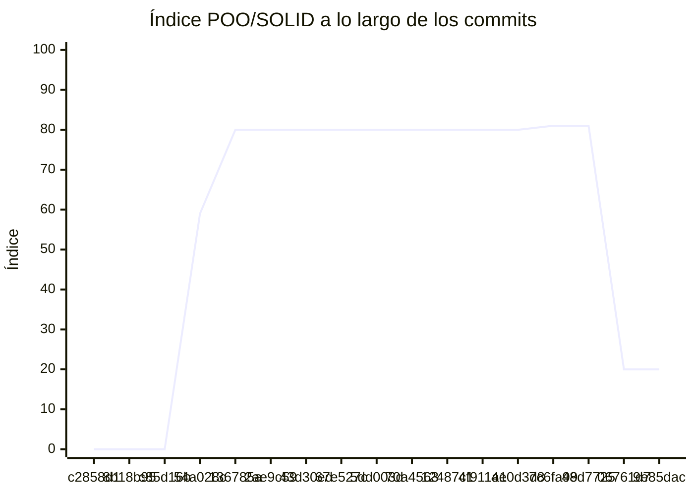

<!-- evaluacion:inicio -->
# Evaluación — Fisicos-informaticos/Tiro_Parab-lico

> Documento **generado automáticamente** por la cátedra de Programación II (RepoSense + análisis de calidad POO/SOLID). **No editar a mano**: se regenera en cada evaluación.
> Rama evaluada: `main`. Análisis **heurístico** (regex + métricas): es una criba para orientar la revisión, **no una nota**.
> Generado: 2026-11-20.

## 1. Veredicto

| Aspecto | Resultado |
|---|---|
| Índice de calidad POO/SOLID | **20/100** |
| Código (LOC) | 6,651 |
| Archivos de código | 147 |
| Clases (bien usadas) | 216 (117 OK) |
| Código dentro de clases (%POO) | 97% |
| Funciones fuera de clases | 11 |
| Duplicación lógica | 5.9% |
| Señales S/O/L/I/D | 45/0/0/1/11 |
| Tope duro aplicado | `SUELTAS>=10` → índice ≤ 20 |

> Este informe **describe** lo que el análisis midió con los criterios ya establecidos de la materia. No es una nota.

### Semáforo de aprobación

Criterios de `CRITERIOS-CALIDAD.md`. **Aprobar** se juega con el perfil `estandar`; **destacar**, con el `exigente` (meta de excelencia).

| Semáforo | Resultado |
|---|---|
| Aprobar (`estandar`) | **no cumple** — 2/4 |
| Destacar (`exigente`) | **no cumple** — 1/5 |

**Criterios para aprobar**

| Criterio | Requisito | Tu resultado | Cumple |
|---|---|---|---|
| Código dentro de clases (%POO) | ≥ 85% | 97% | sí |
| Duplicación lógica | ≤ 10% | 5.9% | sí |
| Funciones fuera de clases | ≤ 1 | 11 | no |
| Señales POO/SOLID críticas | ninguna | Baja cohesión (LCOM), Acoplamiento alto (CBO) | no |

**Criterios para destacar**

| Criterio | Requisito | Tu resultado | Cumple |
|---|---|---|---|
| Código dentro de clases (%POO) | ≥ 95% | 97% | sí |
| Duplicación lógica | ≤ 5% | 5.9% | no |
| Funciones fuera de clases | ≤ 1 | 11 | no |
| Señales POO/SOLID críticas | ninguna | Clase demasiado grande (SRP), Baja cohesión (LCOM), Acoplamiento alto (CBO), Interfaz con demasiados métodos (ISP) | no |
| Índice de calidad POO/SOLID | ≥ 60 | 20/100 | no |

### Cómo se calcula el %POO (y por qué no sube solo)

`%POO = líneas de lógica dentro de clases ÷ líneas de lógica totales`.

Se cuentan las líneas de **lógica y campos**; no cuentan `package`/`import`/`using`/anotaciones ni comentarios, Javadoc o docstrings. Es una **proporción**: si agregás código nuevo dentro de una clase, el numerador y el denominador crecen juntos y el porcentaje casi no cambia.

Sube cuando el código que hoy está **fuera** de clases pasa a ser método de una clase (o desaparece): funciones sueltas, `main`, constantes de módulo, scripts y lógica de archivos sueltos. También importa que ese trabajo esté **integrado en `main`**: la evaluación siempre mide `main`, así que lo que sigue en otra rama no se refleja todavía.

## 2. Autoría (RepoSense)

| Autor | Commits | Código (LOC) | Tests (LOC) | Docs (LOC) | Días activos | % del código |
|---|---:|---:|---:|---:|---:|---:|
| Tomas-Chokita | 11 | 3,760 | 966 | 2 | 8 | 100% |

> _El LOC de autoría lo calcula RepoSense sobre el historial y puede diferir del LOC de código del análisis de calidad (que mira solo el estado de `main`)._

## 3. Fallas detectadas

Reúne lo que el análisis marcó y lo que todavía falta para cada semáforo. Cuando la señal se puede asociar a archivos, se indican para orientar la revisión. No es una nota.

| Falla | Tu resultado | Requisito | Archivos |
|---|---|---|---|
| Funciones fuera de clases | 11 | Aprobar: ≤ 1 Destacar: ≤ 1 | `app/src/main/kotlin/org/example/MainAppSupport.kt` |
| Señales POO/SOLID críticas | Baja cohesión (LCOM), Acoplamiento alto (CBO) | Aprobar: ninguna Destacar: ninguna | `app/src/main/kotlin/org/example/MainApp.kt`, `app/src/main/kotlin/org/example/coordenadas/Camara.kt`, `app/src/main/kotlin/org/example/fisica/DetectorReposo.kt`, `app/src/main/kotlin/org/example/fisica/MotorFisico.kt`, `app/src/main/kotlin/org/example/fisica/ResolutorColisiones.kt`, `app/src/main/kotlin/org/example/fisica/Tierra.kt` (+34 más) |
| Duplicación lógica | 5.9% | Destacar: ≤ 5% | `app/src/test/kotlin/org/example/SimulacionPartidaTest.kt` |
| Índice de calidad POO/SOLID | 20/100 | Destacar: ≥ 60 | — |
| Métodos/funciones largos o con muchos parámetros | **2** método(s)/función(es) largos o con muchos parámetros | Sin señales | `app/src/main/kotlin/org/example/MainAppSupport.kt` |

## 4. Aspectos evaluados

Cada aspecto indica **qué mide**, **por qué importa** y **tu resultado**. Cuando el análisis reportó una señal, se agregan preguntas para **investigar la causa** (no hay recetas: entender el porqué es parte de la evaluación).

### 1. Índice de calidad POO/SOLID (indice)

- **Qué mide:** Un resumen numérico (0-100) que combina la riqueza de clases bien usadas con la penalización por señales POO/SOLID y duplicación, y luego aplica topes duros.
- **Por qué importa:** Ordena y prioriza la revisión: un índice bajo indica varias señales que conviene mirar juntas.
- **Tu resultado:** índice **20/100**

### 2. Duplicación lógica (DRY) (duplicacion) — sin señales

- **Qué mide:** Porcentaje de bloques de LÓGICA repetidos. Quedan fuera imports/includes, anotaciones, declaraciones de campos y comentarios/Javadoc/docstrings: esos bloques son boilerplate, no lógica.
- **Por qué importa:** Cada copia de lógica se mantiene por separado: un arreglo hay que repetirlo y los defectos se multiplican.
- **Tu resultado:** **5.9%** de duplicación lógica

### 3. Adopción de POO (% de código en clases) (poo) — sin señales

- **Qué mide:** Proporción de las **líneas de lógica** que viven dentro de una clase. Quedan fuera `package`/`import`/`using`/anotaciones y comentarios/Javadoc/docstrings: no son código que pueda estar dentro de una clase y, si contaran, el porcentaje quedaría topado por el boilerplate de cada archivo.
- **Por qué importa:** El diseño orientado a objetos es el eje de la materia: el comportamiento debería vivir como método de una clase.
- **Tu resultado:** **97.4%** del código dentro de clases
- **Cómo leerlo:** Es una **proporción**, no un acumulado: agregar código dentro de una clase no la sube por sí solo (numerador y denominador crecen juntos). Sube cuando el código que está **fuera** de clases (funciones sueltas, `main`, constantes de módulo, scripts) pasa a ser método de una clase o deja de existir. La medición se hace sobre `main`: el trabajo que todavía vive en otra rama no se refleja hasta que se integra.

### 4. Funciones fuera de clases (sueltas) — con señales

- **Qué mide:** Funciones de nivel de módulo que no pertenecen a ninguna clase (en esta materia el comportamiento debe ser método de una clase).
- **Por qué importa:** Son la forma más directa de código procedural en un proyecto que debería ser orientado a objetos.
- **Tu resultado:** **11** función(es) fuera de clases
- **Para investigar la causa:**
    - ¿Esa función se dejó suelta por urgencia o por desconocer dónde ubicarla?
    - ¿Qué clase debería ser responsable de ese comportamiento?
    - ¿Había una convención sobre dónde poner cada cosa?

### 5. Clase demasiado grande (SRP) (god) — con señales

- **Qué mide:** Clases con demasiadas líneas o métodos de LÓGICA. No cuentan los getters/setters triviales ni la cantidad de campos por sí sola.
- **Por qué importa:** Una clase que hace de todo cambia por muchos motivos y cuesta entenderla y probarla.
- **Tu resultado:** **1** clase(s) demasiado grande(s)
- **Para investigar la causa:**
    - ¿La clase creció por acumulación de responsabilidades?
    - ¿Qué partes de la clase se usan siempre juntas y cuáles no?
    - ¿Se podría describir su responsabilidad en una sola frase?

### 6. Baja cohesión (LCOM) (cohesion) — con señales

- **Qué mide:** Métodos y campos de una clase que casi no se relacionan entre sí.
- **Por qué importa:** Una unidad que cambia por motivos distintos y comparte poca información suele esconder más de una responsabilidad.
- **Tu resultado:** **44** clase(s) con baja cohesión
- **Para investigar la causa:**
    - ¿Qué métodos de la clase no comparten estado con el resto?
    - ¿Cambian por motivos distintos según la tarea?
    - ¿Se pensó su responsabilidad antes de escribirla, o se fue agregando?

### 7. Complejidad alta (complejidad) — sin señales

- **Qué mide:** Complejidad ciclomática: cantidad de caminos posibles dentro de un método o función (condicionales, bucles, casos).
- **Por qué importa:** Muchos caminos = difícil de seguir y de probar; suelen esconderse casos sin cubrir.
- **Tu resultado:** **0** método(s)/función(es) con complejidad alta

### 8. Métodos/funciones largos o con muchos parámetros (tamano) — con señales

- **Qué mide:** Tamaño de los métodos/funciones y cantidad de parámetros.
- **Por qué importa:** Una función que hace varias cosas cuesta leerla, nombrarla y reutilizarla.
- **Tu resultado:** **2** método(s)/función(es) largos o con muchos parámetros
- **Para investigar la causa:**
    - ¿La función creció por acumulación de pasos?
    - ¿Agrupa operaciones que podrían describirse por separado?
    - ¿Los parámetros representan una misma idea (un objeto) o cosas sueltas?

### 9. Acoplamiento alto (CBO) (acoplamiento) — con señales

- **Qué mide:** Cuánto depende una clase de otros tipos del proyecto. No cuentan los tipos de la plataforma (biblioteca estándar, DOM, motor Godot) ni los métodos/propiedades propias.
- **Por qué importa:** Piezas muy enlazadas hacen que un cambio se propague y que sea difícil reemplazar partes.
- **Tu resultado:** **11** clase(s) muy acoplada(s)
- **Para investigar la causa:**
    - ¿La clase conoce detalles internos de muchas otras?
    - ¿Se puede cambiar una parte sin tocar las demás?
    - ¿Los colaboradores llegan como parámetros o se crean por dentro?

### 10. Herencia profunda (DIT) (herencia) — sin señales

- **Qué mide:** Profundidad de la cadena de herencia de una clase.
- **Por qué importa:** Jerarquías muy profundas vuelven difícil saber de dónde viene cada comportamiento.
- **Tu resultado:** **0** clase(s) con herencia profunda

### 11. Switch sobre tipos (OCP) (ocp) — sin señales

- **Qué mide:** Cadenas de dispatch por tipo (`else if ... is` / `else if ... instanceof`, `switch` sobre tipo o `typeof`). Un `is Tipo variable` aislado (pattern matching / cast seguro) NO cuenta como switch.
- **Por qué importa:** Cada tipo nuevo obliga a tocar varios lugares, en vez de extender con una implementación nueva.
- **Tu resultado:** **0** clase(s) con switch sobre tipos

### 12. Interfaz con demasiados métodos (ISP) (isp) — con señales

- **Qué mide:** Interfaces o clases abstractas con muchos métodos declarados.
- **Por qué importa:** Obliga a implementar operaciones que no se usan y acopla a los clientes a métodos que no necesitan.
- **Tu resultado:** **1** interfaz(es) con demasiados métodos
- **Para investigar la causa:**
    - ¿Qué subconjunto de métodos usa realmente cada implementación?
    - ¿Se agruparon métodos de necesidades distintas en la misma interfaz?
    - ¿Hay implementaciones que dejan métodos sin uso?

### 13. Override vacío o 'no implementado' (LSP) (lsp) — sin señales

- **Qué mide:** Métodos sobrescritos que quedan vacíos o lanzan 'no implementado'.
- **Por qué importa:** Suele indicar que la jerarquía no representa bien el problema y rompe la sustitución entre clases.
- **Tu resultado:** **0** override(s) vacío(s) o 'no implementado'

### 14. Clase sin métodos (solo datos) (data) — sin señales

- **Qué mide:** Clases que solo acumulan campos y no tienen comportamiento.
- **Por qué importa:** Separar datos de comportamiento reparte por el proyecto la lógica que debería estar cerca de esos datos.
- **Tu resultado:** **0** clase(s) sin métodos (solo datos)

### 15. Campos mutables públicos (encapsulación) (encapsulacion) — sin señales

- **Qué mide:** Clases que exponen estado **modificable** desde afuera. No cuentan constantes (`static final`, `const`), campos `final`/`readonly`, propiedades `val` de Kotlin ni propiedades con `private set`.
- **Por qué importa:** Expone el estado interno y hace que cualquier cambio dependa de quién lo modifica desde afuera.
- **Tu resultado:** **0** clase(s) con campos mutables públicos

### 16. Clase solo con métodos estáticos (utilitaria) (static) — sin señales

- **Qué mide:** Clases donde todos los métodos son estáticos.
- **Por qué importa:** Es comportamiento procedural disfrazado de clase: no se instancia ni participa del modelo de objetos.
- **Tu resultado:** **0** clase(s) solo con métodos estáticos

### Archivos donde se originan las señales

> Se listan **76** hallazgo(s) localizados en **42** archivo(s). La columna `Línea` es la línea del archivo donde el análisis detectó la señal; `—` indica una señal de nivel repositorio (sin archivo propio).

| Aspecto | Archivo | Línea | Hallazgo |
|---|---|---:|---|
| Duplicación lógica (DRY) | — | — | duplicación lógica: 5.9% · boilerplate: 1.2% |
| Duplicación lógica (DRY) | `app/src/test/kotlin/org/example/SimulacionPartidaTest.kt` | 55 | bloque de 8 líneas repetido 4 veces en app/src/test/kotlin/org/example/SimulacionPartidaTest.kt:55, app/src/test/kotlin/org/example/SimulacionTest.kt:205, app/src/test/kotlin/org/example/SimulacionParedesTest.kt:87 |
| Duplicación lógica (DRY) | `app/src/test/kotlin/org/example/SimulacionPartidaTest.kt` | 56 | bloque de 8 líneas repetido 4 veces en app/src/test/kotlin/org/example/SimulacionPartidaTest.kt:56, app/src/test/kotlin/org/example/SimulacionTest.kt:206, app/src/test/kotlin/org/example/SimulacionParedesTest.kt:88 |
| Duplicación lógica (DRY) | `app/src/test/kotlin/org/example/SimulacionPartidaTest.kt` | 61 | bloque de 8 líneas repetido 4 veces en app/src/test/kotlin/org/example/SimulacionPartidaTest.kt:61, app/src/test/kotlin/org/example/SimulacionTest.kt:211, app/src/test/kotlin/org/example/SimulacionParedesTest.kt:93 |
| Duplicación lógica (DRY) | `app/src/test/kotlin/org/example/SimulacionPartidaTest.kt` | 80 | bloque de 8 líneas repetido 5 veces en app/src/test/kotlin/org/example/SimulacionPartidaTest.kt:80, app/src/test/kotlin/org/example/SimulacionTest.kt:230, app/src/test/kotlin/org/example/SimulacionParedesTest.kt:112 |
| Duplicación lógica (DRY) | `app/src/test/kotlin/org/example/SimulacionPartidaTest.kt` | 82 | bloque de 8 líneas repetido 4 veces en app/src/test/kotlin/org/example/SimulacionPartidaTest.kt:82, app/src/test/kotlin/org/example/SimulacionTest.kt:232, app/src/test/kotlin/org/example/SimulacionParedesTest.kt:114 |
| Funciones fuera de clases | `app/src/main/kotlin/org/example/MainAppSupport.kt` | 33 | función 'crearCanvas' fuera de una clase |
| Funciones fuera de clases | `app/src/main/kotlin/org/example/MainAppSupport.kt` | 37 | función 'crearPresentador' fuera de una clase |
| Funciones fuera de clases | `app/src/main/kotlin/org/example/MainAppSupport.kt` | 43 | función 'crearUiRefs' fuera de una clase |
| Funciones fuera de clases | `app/src/main/kotlin/org/example/MainAppSupport.kt` | 63 | función 'crearEscenaRoot' fuera de una clase |
| Funciones fuera de clases | `app/src/main/kotlin/org/example/MainAppSupport.kt` | 73 | función 'enlazarEventos' fuera de una clase |
| Funciones fuera de clases | `app/src/main/kotlin/org/example/MainAppSupport.kt` | 77 | función 'ejecutarAccionConBloqueo' fuera de una clase |
| Funciones fuera de clases | `app/src/main/kotlin/org/example/MainAppSupport.kt` | 83 | función 'reiniciarPartida' fuera de una clase |
| Funciones fuera de clases | `app/src/main/kotlin/org/example/MainAppSupport.kt` | 91 | función 'volverAlMenuApp' fuera de una clase |
| Funciones fuera de clases | `app/src/main/kotlin/org/example/MainAppSupport.kt` | 99 | función 'alternarPausaApp' fuera de una clase |
| Funciones fuera de clases | `app/src/main/kotlin/org/example/MainAppSupport.kt` | 106 | función 'alternarMenuPelotasApp' fuera de una clase |
| Funciones fuera de clases | `app/src/main/kotlin/org/example/MainAppSupport.kt` | 111 | función 'alternarMenuParedesApp' fuera de una clase |
| Clase demasiado grande (SRP) | `app/src/test/kotlin/org/example/SimulacionTest.kt` | 19 | clase 'SimulacionTest' grande (LOC lógico=155, métodos=18, campos=0) |
| Baja cohesión (LCOM) | `app/src/main/kotlin/org/example/coordenadas/Camara.kt` | 22 | clase 'CamaraSimulacion' con baja cohesión (17%) |
| Baja cohesión (LCOM) | `app/src/main/kotlin/org/example/fisica/DetectorReposo.kt` | 7 | clase 'DetectorReposo' con baja cohesión (17%) |
| Baja cohesión (LCOM) | `app/src/main/kotlin/org/example/fisica/MotorFisico.kt` | 10 | clase 'MotorFisico' con baja cohesión (26%) |
| Baja cohesión (LCOM) | `app/src/main/kotlin/org/example/fisica/ResolutorColisiones.kt` | 23 | clase 'ResolutorColisiones' con baja cohesión (17%) |
| Baja cohesión (LCOM) | `app/src/main/kotlin/org/example/fisica/Tierra.kt` | 5 | clase 'Tierra' con baja cohesión (4%) |
| Baja cohesión (LCOM) | `app/src/main/kotlin/org/example/grafico/CanvasRenderer.kt` | 9 | clase 'CanvasRenderer' con baja cohesión (25%) |
| Baja cohesión (LCOM) | `app/src/main/kotlin/org/example/grafico/ContextoDibujo.kt` | 16 | clase 'LineaDibujo' con baja cohesión (20%) |
| Baja cohesión (LCOM) | `app/src/main/kotlin/org/example/grafico/ContextoDibujo.kt` | 42 | clase 'ImagenEnMundo' con baja cohesión (30%) |
| Baja cohesión (LCOM) | `app/src/main/kotlin/org/example/grafico/DibujanteParedes.kt` | 13 | clase 'DibujanteParedes' con baja cohesión (33%) |
| Baja cohesión (LCOM) | `app/src/main/kotlin/org/example/grafico/DibujoPelota.kt` | 13 | clase 'VistaPelota' con baja cohesión (29%) |
| Baja cohesión (LCOM) | `app/src/main/kotlin/org/example/grafico/FlechaGeometria.kt` | 5 | clase 'FlechaGeometria' con baja cohesión (7%) |
| Baja cohesión (LCOM) | `app/src/main/kotlin/org/example/grafico/PresentadorJuego.kt` | 25 | clase 'PresentadorJuego' con baja cohesión (10%) |
| Baja cohesión (LCOM) | `app/src/main/kotlin/org/example/grafico/TrazoVector.kt` | 6 | clase 'TrazoVector' con baja cohesión (7%) |
| Baja cohesión (LCOM) | `app/src/main/kotlin/org/example/modelo/Pelota.kt` | 5 | clase 'Pelota' con baja cohesión (21%) |
| Baja cohesión (LCOM) | `app/src/main/kotlin/org/example/modelo/TipoPared.kt` | 3 | clase 'TipoPared' con baja cohesión (13%) |
| Baja cohesión (LCOM) | `app/src/main/kotlin/org/example/modelo/TipoPelota.kt` | 9 | clase 'TipoPelota' con baja cohesión (5%) |
| Baja cohesión (LCOM) | `app/src/main/kotlin/org/example/modelo/colision/FormaColision.kt` | 17 | clase 'DatosContactoPlano' con baja cohesión (40%) |
| Baja cohesión (LCOM) | `app/src/main/kotlin/org/example/modelo/colision/FormasColision.kt` | 27 | clase 'FormaCapsula' con baja cohesión (24%) |
| Baja cohesión (LCOM) | `app/src/main/kotlin/org/example/modelo/colision/FormasColision.kt` | 65 | clase 'FormaCaja' con baja cohesión (18%) |
| Baja cohesión (LCOM) | `app/src/main/kotlin/org/example/modelo/colision/FormasColision.kt` | 101 | clase 'FormaPoligono' con baja cohesión (14%) |
| Baja cohesión (LCOM) | `app/src/main/kotlin/org/example/modos/ModoSimulacion.kt` | 30 | clase 'Preparacion' con baja cohesión (25%) |
| Baja cohesión (LCOM) | `app/src/main/kotlin/org/example/modos/ModoSimulacion.kt` | 49 | clase 'LecturaModo' con baja cohesión (9%) |
| Baja cohesión (LCOM) | `app/src/main/kotlin/org/example/simulacion/ComponentesSimulacion.kt` | 14 | clase 'ComponentesFisica' con baja cohesión (0%) |
| Baja cohesión (LCOM) | `app/src/main/kotlin/org/example/simulacion/ComponentesSimulacion.kt` | 35 | clase 'ComponentesPartida' con baja cohesión (0%) |
| Baja cohesión (LCOM) | `app/src/main/kotlin/org/example/simulacion/ComponentesSimulacion.kt` | 50 | clase 'ServiciosCableados' con baja cohesión (0%) |
| Baja cohesión (LCOM) | `app/src/main/kotlin/org/example/simulacion/EnsambladorServicios.kt` | 7 | clase 'ContextoServicios' con baja cohesión (14%) |
| Baja cohesión (LCOM) | `app/src/main/kotlin/org/example/simulacion/EnsambladorServicios.kt` | 23 | clase 'ContextoComandos' con baja cohesión (5%) |
| Baja cohesión (LCOM) | `app/src/main/kotlin/org/example/simulacion/MetricasTiro.kt` | 6 | clase 'MetricasTiro' con baja cohesión (33%) |
| Baja cohesión (LCOM) | `app/src/main/kotlin/org/example/simulacion/Puertos.kt` | 95 | clase 'ContextoVuelo' con baja cohesión (33%) |
| Baja cohesión (LCOM) | `app/src/main/kotlin/org/example/simulacion/ResultadoSimulacion.kt` | 3 | clase 'ResultadoSimulacion' con baja cohesión (20%) |
| Baja cohesión (LCOM) | `app/src/main/kotlin/org/example/simulacion/SesionPartida.kt` | 9 | clase 'SesionPartida' con baja cohesión (13%) |
| Baja cohesión (LCOM) | `app/src/main/kotlin/org/example/simulacion/Simulacion.kt` | 13 | clase 'Simulacion' con baja cohesión (38%) |
| Baja cohesión (LCOM) | `app/src/main/kotlin/org/example/simulacion/SimulacionConsultas.kt` | 17 | clase 'SimulacionConsultas' con baja cohesión (19%) |
| Baja cohesión (LCOM) | `app/src/main/kotlin/org/example/sprites/SpriteEstatico.kt` | 8 | clase 'SpriteEstatico' con baja cohesión (27%) |
| Baja cohesión (LCOM) | `app/src/main/kotlin/org/example/ui/ConfiguracionPanelSimulacion.kt` | 3 | clase 'ConfiguracionPanelSimulacion' con baja cohesión (33%) |
| Baja cohesión (LCOM) | `app/src/main/kotlin/org/example/ui/ConstructorMenu.kt` | 16 | clase 'ConstructorMenu' con baja cohesión (5%) |
| Baja cohesión (LCOM) | `app/src/main/kotlin/org/example/ui/ConstructorMenu.kt` | 23 | clase 'EspecificacionMenu' con baja cohesión (13%) |
| Baja cohesión (LCOM) | `app/src/main/kotlin/org/example/ui/ConstructorMenu.kt` | 37 | clase 'EspecificacionBotonMenu' con baja cohesión (0%) |
| Baja cohesión (LCOM) | `app/src/main/kotlin/org/example/ui/ConstructorMenu.kt` | 54 | clase 'EspecificacionTextos' con baja cohesión (20%) |
| Baja cohesión (LCOM) | `app/src/main/kotlin/org/example/ui/ConstructorPanel.kt` | 14 | clase 'ConstructorPanel' con baja cohesión (20%) |
| Baja cohesión (LCOM) | `app/src/main/kotlin/org/example/ui/ConstructorPanel.kt` | 15 | clase 'EspecificacionCombo' con baja cohesión (20%) |
| Baja cohesión (LCOM) | `app/src/main/kotlin/org/example/ui/EstadoPanel.kt` | 3 | clase 'EstadoPanel' con baja cohesión (6%) |
| Baja cohesión (LCOM) | `app/src/main/kotlin/org/example/ui/MenuFinJuego.kt` | 20 | clase 'MenuFinJuego' con baja cohesión (40%) |
| Baja cohesión (LCOM) | `app/src/main/kotlin/org/example/ui/MenusJuego.kt` | 11 | clase 'MenusJuego' con baja cohesión (14%) |
| Métodos/funciones largos o con muchos parámetros | `app/src/main/kotlin/org/example/MainAppSupport.kt` | 63 | función 'crearEscenaRoot' con 5 parámetros |
| Métodos/funciones largos o con muchos parámetros | `app/src/main/kotlin/org/example/MainAppSupport.kt` | 73 | función 'enlazarEventos' con 5 parámetros |
| Acoplamiento alto (CBO) | `app/src/main/kotlin/org/example/MainApp.kt` | 11 | clase 'MainApp' muy acoplada (CBO=8) |
| Acoplamiento alto (CBO) | `app/src/main/kotlin/org/example/fisica/MotorFisico.kt` | 10 | clase 'MotorFisico' muy acoplada (CBO=8) |
| Acoplamiento alto (CBO) | `app/src/main/kotlin/org/example/grafico/CanvasRenderer.kt` | 9 | clase 'CanvasRenderer' muy acoplada (CBO=15) |
| Acoplamiento alto (CBO) | `app/src/main/kotlin/org/example/simulacion/ComandosEdicion.kt` | 10 | clase 'ComandosEdicion' muy acoplada (CBO=9) |
| Acoplamiento alto (CBO) | `app/src/main/kotlin/org/example/simulacion/ComandosPartida.kt` | 12 | clase 'ComandosPartida' muy acoplada (CBO=13) |
| Acoplamiento alto (CBO) | `app/src/main/kotlin/org/example/simulacion/ComponentesSimulacion.kt` | 14 | clase 'ComponentesFisica' muy acoplada (CBO=8) |
| Acoplamiento alto (CBO) | `app/src/main/kotlin/org/example/simulacion/FabricaSimulacion.kt` | 23 | clase 'FabricaSimulacion' muy acoplada (CBO=11) |
| Acoplamiento alto (CBO) | `app/src/main/kotlin/org/example/simulacion/MecanicaTiro.kt` | 10 | clase 'MecanicaTiro' muy acoplada (CBO=8) |
| Acoplamiento alto (CBO) | `app/src/main/kotlin/org/example/simulacion/PosicionPelota.kt` | 10 | clase 'PosicionPelota' muy acoplada (CBO=8) |
| Acoplamiento alto (CBO) | `app/src/main/kotlin/org/example/simulacion/Simulacion.kt` | 13 | clase 'Simulacion' muy acoplada (CBO=17) |
| Acoplamiento alto (CBO) | `app/src/main/kotlin/org/example/simulacion/SimulacionConsultas.kt` | 17 | clase 'SimulacionConsultas' muy acoplada (CBO=22) |
| Interfaz con demasiados métodos (ISP) | `app/src/main/kotlin/org/example/modelo/colision/FormaColision.kt` | 42 | interfaz 'FormaColision' con 7 métodos |

### Desglose de la columna S (SRP)

> La columna **S** no es un puntaje: cuenta **señales** de SRP. Aquí suma **45** entrada(s) sobre **45** clase(s) distinta(s).

| Señal | Entradas | Regla (perfil exigente) |
|---|---:|---|
| Clase grande | 1 | ≥ 200 LOC lógico, o ≥ 15 métodos con lógica y ≥ 100 LOC lógico. No cuentan getters/setters. |
| Cohesión baja | 44 | < 50 % de los pares de métodos comparten algún campo (con ≥ 4 métodos con lógica y ≥ 3 campos). |

**Clases grandes (1)**

- `SimulacionTest`: clase grande (LOC lógico=155, métodos=18, campos=0)

**Clases con baja cohesión (44)**

- `ComponentesFisica`: cohesión baja (0% de pares comparten campos)
- `ComponentesPartida`: cohesión baja (0% de pares comparten campos)
- `ServiciosCableados`: cohesión baja (0% de pares comparten campos)
- `EspecificacionBotonMenu`: cohesión baja (0% de pares comparten campos)
- `Tierra`: cohesión baja (4% de pares comparten campos)
- `ContextoComandos`: cohesión baja (5% de pares comparten campos)
- `TipoPelota`: cohesión baja (5% de pares comparten campos)
- `ConstructorMenu`: cohesión baja (5% de pares comparten campos)
- `EstadoPanel`: cohesión baja (6% de pares comparten campos)
- `FlechaGeometria`: cohesión baja (7% de pares comparten campos)
- `TrazoVector`: cohesión baja (7% de pares comparten campos)
- `LecturaModo`: cohesión baja (9% de pares comparten campos)
- `PresentadorJuego`: cohesión baja (10% de pares comparten campos)
- `SesionPartida`: cohesión baja (13% de pares comparten campos)
- `TipoPared`: cohesión baja (13% de pares comparten campos)
- `EspecificacionMenu`: cohesión baja (13% de pares comparten campos)
- `ContextoServicios`: cohesión baja (14% de pares comparten campos)
- `FormaPoligono`: cohesión baja (14% de pares comparten campos)
- `MenusJuego`: cohesión baja (14% de pares comparten campos)
- `DetectorReposo`: cohesión baja (17% de pares comparten campos)
- `ResolutorColisiones`: cohesión baja (17% de pares comparten campos)
- `CamaraSimulacion`: cohesión baja (17% de pares comparten campos)
- `FormaCaja`: cohesión baja (18% de pares comparten campos)
- `SimulacionConsultas`: cohesión baja (19% de pares comparten campos)
- `ResultadoSimulacion`: cohesión baja (20% de pares comparten campos)
- `LineaDibujo`: cohesión baja (20% de pares comparten campos)
- `ConstructorPanel`: cohesión baja (20% de pares comparten campos)
- `EspecificacionCombo`: cohesión baja (20% de pares comparten campos)
- `EspecificacionTextos`: cohesión baja (20% de pares comparten campos)
- `Pelota`: cohesión baja (21% de pares comparten campos)
- `FormaCapsula`: cohesión baja (24% de pares comparten campos)
- `CanvasRenderer`: cohesión baja (25% de pares comparten campos)
- `Preparacion`: cohesión baja (25% de pares comparten campos)
- `MotorFisico`: cohesión baja (26% de pares comparten campos)
- `SpriteEstatico`: cohesión baja (27% de pares comparten campos)
- `VistaPelota`: cohesión baja (29% de pares comparten campos)
- `ImagenEnMundo`: cohesión baja (30% de pares comparten campos)
- `MetricasTiro`: cohesión baja (33% de pares comparten campos)
- `ContextoVuelo`: cohesión baja (33% de pares comparten campos)
- `DibujanteParedes`: cohesión baja (33% de pares comparten campos)
- `ConfiguracionPanelSimulacion`: cohesión baja (33% de pares comparten campos)
- `Simulacion`: cohesión baja (38% de pares comparten campos)
- `DatosContactoPlano`: cohesión baja (40% de pares comparten campos)
- `MenuFinJuego`: cohesión baja (40% de pares comparten campos)

> Los **2** hallazgo(s) de métodos largos o con muchos parámetros se listan en «Métodos/funciones largos o con muchos parámetros» y **no suman** a la columna S.

> El análisis no excluye tests: una clase de test que supere los umbrales también suma.

## 5. Evolución por commit

Métricas calculadas sobre el estado de `main` en **cada commit** (17 commits con trabajo), del primero al último. La calidad usa el perfil `exigente`; el aporte de código lo mide RepoSense. El índice puede **bajar** al crecer el proyecto: se acumulan señales.

| # | Fecha | Commit | Autor | LOC | Índice | %POO | Duplic. | Sueltas |
|---|---|---|---|---:|---:|---:|---:|---:|
| 1 | 2026-08-14 | `c2858d1` | Tomas-Chokita | 0 | 0 | 0% | 0.0% | 0 |
| 2 | 2026-08-14 | `8b18b95` | Tomas-Chokita | 0 | 0 | 0% | 0.0% | 0 |
| 3 | 2026-08-24 | `c85d16b` | dqmdz-etec | 0 | 0 | 0% | 0.0% | 0 |
| 4 | 2026-09-04 | `54a028c` | Tomas-Chokita | 175 | 59 | 76% | 0.0% | 0 |
| 5 | 2026-10-16 | `136785a` | Tomas-Chokita | 3,963 | 80 | 98% | 1.3% | 0 |
| 6 | 2026-11-07 | `2ae9c59` | dqmdz-etec | 3,963 | 80 | 98% | 1.3% | 0 |
| 7 | 2026-11-07 | `43d30ed` | dqmdz-etec | 3,963 | 80 | 98% | 1.3% | 0 |
| 8 | 2026-11-07 | `67e527c` | dqmdz-etec | 3,963 | 80 | 98% | 1.3% | 0 |
| 9 | 2026-11-07 | `5dd003d` | dqmdz-etec | 3,963 | 80 | 98% | 1.3% | 0 |
| 10 | 2026-11-13 | `70a4563` | dqmdz-etec | 3,963 | 80 | 98% | 1.3% | 0 |
| 11 | 2026-11-14 | `12487c1` | dqmdz-etec | 3,963 | 80 | 98% | 1.3% | 0 |
| 12 | 2026-11-16 | `4f911a1` | dqmdz-etec | 3,963 | 80 | 98% | 1.3% | 0 |
| 13 | 2026-11-17 | `4e0d3d8` | dqmdz-etec | 3,963 | 80 | 98% | 1.3% | 0 |
| 14 | 2026-11-19 | `7c6fa99` | dqmdz-etec | 6,694 | 81 | 99% | 0.7% | 0 |
| 15 | 2026-11-20 | `48d7725` | dqmdz-etec | 6,694 | 81 | 99% | 0.7% | 0 |
| 16 | 2026-11-20 | `06761d7` | dqmdz-etec | 6,651 | 20 | 97% | 5.9% | 11 |
| 17 | 2026-11-20 | `9e85dac` | dqmdz-etec | 6,651 | 20 | 97% | 5.9% | 11 |

<!-- actividad-clases:inicio -->
## Actividad en días de clase

> Período evaluado **2026-08-14 → 2026-11-20** · **23 clases** (lunes, viernes) · días de clase del calendario, extendidos hasta la fecha de corte.
>
> `Commits` = commits de trabajo (no-merge); `Merges` = merges de PR (también son push). Los días sin actividad dicen **sin actividad**. El cuadro principal usa sólo las fechas de clase del calendario oficial.
>
> **Aportes fuera del calendario:** cada alumno tiene un cuadro aparte con las fechas no lectivas con actividad, desde **2026-08-14** hasta **2026-11-20** (ventana de aportes). Esas fechas no forman parte del cuadro principal, pero se muestran para no perder trabajo hecho en fines de semana, feriados o después del período.
>
> Se recorre `git log --all` sobre un mirror (todas las ramas y `refs/pull/*`), con deduplicación por commit. Fecha = fecha de autor en UTC-3. Los commits locales no pusheados no se ven. Si el trabajo fue en pareja y el commit es de otra persona, figura a nombre del autor del commit; para reflejarlo, usar `Co-authored-by` o una nota manual.
>
> Sección informativa: no modifica el semáforo de aprobación.

### Tomas-Chokita

**17/23 clases con actividad** · 22 commits · 2 merges

| Fecha | Marca | Repositorios | Commits / merges |
|---|:--:|---|--:|
| 2026-08-14 | **Sí** | Tiro_Parab-lico | 4 / 0 |
| 2026-08-21 | **Sí** | Tiro_Parab-lico | 1 / 0 |
| 2026-08-24 | No | sin actividad | 0 / 0 |
| 2026-08-28 | **Sí** | Tiro_Parab-lico | 1 / 0 |
| 2026-08-31 | No | sin actividad | 0 / 0 |
| 2026-09-04 | **Sí** | Tiro_Parab-lico | 0 / 1 |
| 2026-09-07 | No | sin actividad | 0 / 0 |
| 2026-09-14 | No | sin actividad | 0 / 0 |
| 2026-09-25 | **Sí** | Tiro_Parab-lico | 1 / 0 |
| 2026-09-28 | **Sí** | Tiro_Parab-lico | 1 / 0 |
| 2026-10-02 | **Sí** | Tiro_Parab-lico | 2 / 0 |
| 2026-10-05 | No | sin actividad | 0 / 0 |
| 2026-10-09 | **Sí** | Tiro_Parab-lico | 1 / 0 |
| 2026-10-16 | **Sí** | Tiro_Parab-lico | 2 / 1 |
| 2026-10-19 | No | sin actividad | 0 / 0 |
| 2026-10-23 | **Sí** | Tiro_Parab-lico | 1 / 0 |
| 2026-10-26 | **Sí** | Tiro_Parab-lico | 1 / 0 |
| 2026-10-30 | **Sí** | Tiro_Parab-lico | 1 / 0 |
| 2026-11-02 | **Sí** | Tiro_Parab-lico | 1 / 0 |
| 2026-11-06 | **Sí** | Tiro_Parab-lico | 1 / 0 |
| 2026-11-13 | **Sí** | Tiro_Parab-lico | 2 / 0 |
| 2026-11-16 | **Sí** | Tiro_Parab-lico | 1 / 0 |
| 2026-11-20 | **Sí** | Tiro_Parab-lico | 1 / 0 |

#### Aportes fuera del calendario de clases — Tomas-Chokita

_Sin aportes fuera del calendario de clases para Tomas-Chokita._

<!-- actividad-clases:fin -->

---
_Informe generado por la cátedra. Los criterios y umbrales de medición corresponden al perfil `exigente` de `calidad.py`; el semáforo de aprobación, a `CRITERIOS-CALIDAD.md` (ver `README.md`). Ante dudas, revisá el archivo señalado._
<!-- evaluacion:fin -->
